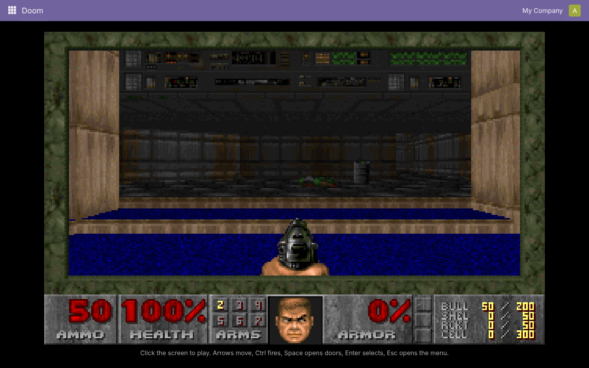
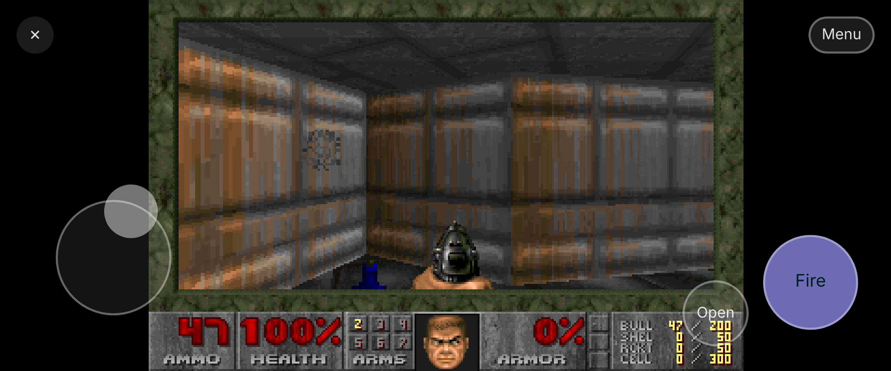

# ODooM

ODooM: an unofficial, non-commercial fan project that runs Doom in Odoo 19. One menu item, the shareware episode, running as WebAssembly in the browser.

## Install

Put `pan_doom/` on your addons path and install the **ODooM** app. Open it from the app menu.
Click the screen, then: arrows move, Ctrl fires, Space opens doors, Enter selects, Esc opens the menu.

On a phone or tablet the game takes the whole screen, like a mobile game. Put your left thumb
anywhere on the left half for a joystick (forward, back, turn). Fire is the big button on the
right and also picks menu items; Open is next to it. Menu and ✕ (back to Odoo) are at the top.
There is no weapon switching on touch; Doom switches when you pick up a new weapon.

## How it works

`pan_doom/static/lib/doom/doom.wasm` is Doom compiled to WebAssembly, with the shareware
`doom1.wad` built in. An OWL client action (`static/src/doom_action.js`, about 80 lines) loads it,
draws each frame on a canvas and passes key presses from the canvas to the game, so Odoo's own
shortcuts stay out of the way.

## Legal

**This is an unofficial, non-commercial fan project.** It is a hobby experiment: it is not for
sale, is not a product or service, and never will be. It has no connection to, and is not
endorsed by, id Software, ZeniMax Media, Bethesda Softworks, Microsoft or Odoo S.A.

- **No rights claimed.** DOOM and every name, logo, image, sound and level from the game belong
  to their owners (id Software / ZeniMax Media). DOOM is their trademark and is used here only
  to say what this module runs. Odoo is a trademark of Odoo S.A.
- **Engine:** the DOOM source code that id Software released under the GNU GPL, version 2 or
  later. The full license text is in [LICENSE](LICENSE). The WebAssembly build and its source
  come from [diekmann/wasm-fizzbuzz](https://github.com/diekmann/wasm-fizzbuzz/tree/gh-pages/doom),
  taken unchanged from the [wasm-doom](https://www.npmjs.com/package/wasm-doom) npm package (v1.2.0).
- **Game data:** the unmodified shareware episode (`doom1.wad`, built into the wasm), which id
  Software allows to be passed on for free. It may not be sold or bundled with anything that is.
  The full game is not included.
- **Our own code** (the Odoo module around the engine) is GPL-2.0 or later as well.
- **No warranty.** Provided as is, without any warranty, as the GPL says.
- **Takedown.** If you hold rights to anything in here and want it gone, open an issue and it
  will be taken down.
