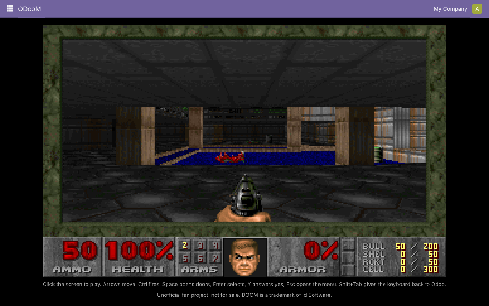
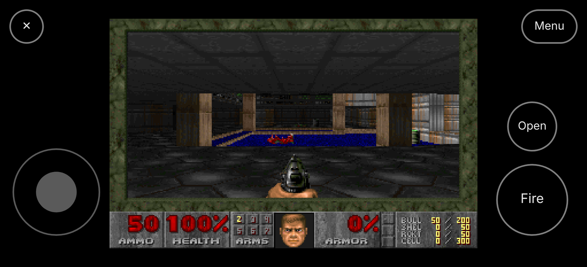

# ODooM

ODooM: an unofficial, non-commercial fan project that runs Doom in Odoo 19. One menu item, the shareware episode, running as WebAssembly in the browser.

## Install

Add the repository folder (the one that holds `pan_doom/`) to your addons path, restart Odoo,
run Apps > Update Apps List, and install **ODooM**. Open it from the app menu.

## Play

**On a computer:** click the screen. Arrows move, Ctrl fires, Space opens doors, Enter selects,
Y answers yes, Esc opens the menu. Shift runs, Alt strafes, 1 to 7 pick a weapon. Shift+Tab gives
the keyboard back to Odoo.

**On a phone or tablet:** the game covers Odoo's screen. Put your left thumb on the lower left for a
joystick (forward, back, turn). Fire is the big button on the right; it also picks menu items and
answers yes. Open sits above it. Menu and ✕ (back to Odoo's home screen) are at the top. Turn the
phone sideways for a bigger picture: on Android the game then goes full screen after your first
touch, on iPhone Safari's own bars stay. There is no weapon switching on touch; Doom switches when
you pick up a new weapon. Because Fire also answers yes, a game saved on touch gets a "Y" at the
end of its name.

There is no sound.

## How it works

`pan_doom/static/lib/doom/doom.wasm.gz` is Doom compiled to WebAssembly with the shareware
`doom1.wad` built in, gzipped from 6.8 to 2.2 MB. Where it comes from and how to check it is in
[its README](pan_doom/static/lib/doom/README.md). An OWL client action
(`static/src/doom_action.js`) unpacks and loads it, draws each frame on a canvas and passes key
presses from the canvas to the game, so Odoo's own shortcuts stay out of the way. On touch screens
`static/src/touch_controls.js` draws the joystick and buttons and sends the same Doom keys.

If the game cannot start (no WebAssembly, the download fails) it says why on the screen.

Tests: `odoo -d <db> -u pan_doom --test-enable --test-tags=/pan_doom --stop-after-init`. One of
them opens the game in headless Chrome, so Chrome and `websocket-client` need to be installed.

## Legal

**This is an unofficial, non-commercial fan project.** It is a hobby experiment: it is not for
sale, is not a product or service, and never will be. It has no connection to, and is not
endorsed by, id Software, ZeniMax Media, Bethesda Softworks, Microsoft or Odoo S.A.

- **No rights claimed.** DOOM and every name, logo, image, sound and level from the game belong
  to their owners (id Software / ZeniMax Media). DOOM is their trademark and is used here only
  to say what this module runs. Odoo is a trademark of Odoo S.A.
- **Engine:** the DOOM source code that id Software released under the GNU GPL, version 2 or
  later, distributed here under GPL-3.0. The full license text is in [LICENSE](LICENSE). The
  WebAssembly build and its source come from [diekmann/wasm-fizzbuzz](https://github.com/diekmann/wasm-fizzbuzz/tree/gh-pages/doom),
  taken unchanged from the [wasm-doom](https://www.npmjs.com/package/wasm-doom) npm package (v1.2.0).
- **Game data:** the unmodified shareware episode (`doom1.wad`, built into the wasm), which id
  Software allows to be passed on for free. It may not be sold or bundled with anything that is.
  The full game is not included.
- **Our own code** (the Odoo module around the engine) is GPL-3.0.
- **No warranty.** Provided as is, without any warranty, as the GPL says.
- **Takedown.** If you hold rights to anything in here and want it gone, open an issue and it
  will be taken down.
